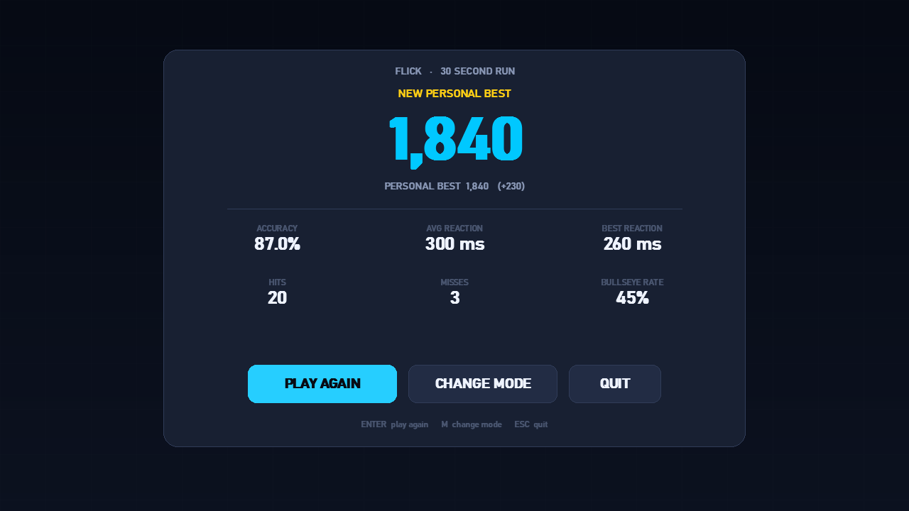

# Aim Trainer

A fast, polished aim trainer built with **Python** and **pygame**.
Three training modes, live accuracy tracking, per-mode personal bests, and no
external asset files.

[](https://github.com/nasredine001/aim-trainer/releases/latest)
[](https://github.com/nasredine001/aim-trainer/actions/workflows/build.yml)
[](LICENSE)

<p align="center">
  
</p>

## Download (Windows)

Grab the latest **`AimTrainer.exe`** from the
[Releases page](https://github.com/nasredine001/aim-trainer/releases/latest).
It is a single ~14 MB file — no Python installation required.

> The executable is unsigned, so Windows SmartScreen may warn on first launch.
> Choose **More info → Run anyway** if you trust the source.

## Features

- **Flick mode** — static targets, one at a time. Click fast, click centre.
- **Moving mode** — targets bounce around the arena. Predict and flick.
- **Tracking mode** — hold left mouse to fire and keep the crosshair on a moving target.
- **Live HUD** with timer, score, accuracy, and a custom crosshair.
- **Detailed results** — accuracy, average/best reaction time, hits, misses, and bullseye rate.
- **Personal bests** per mode, saved automatically (source: `data/stats.json`;
  exe: `%APPDATA%\AimTrainer\stats.json`).
- **Synthesized sound effects** generated at startup — no audio files to download.
- 120 FPS game loop, hit markers, floating score, and target spawn animations.

## Run from source

Requires **Python 3.10+**.

```bash
python -m pip install -r requirements.txt
python main.py
```

On Windows, if `python` opens the Microsoft Store, install Python from
[python.org](https://www.python.org/downloads/) and tick **Add python.exe to PATH**.

### Options

```bash
python main.py --mute     # start with sound disabled
```

## Controls

| Screen | Key / input | Action |
| --- | --- | --- |
| Menu | `1` `2` `3` | Select mode |
| Menu | `←` `→` | Change duration |
| Menu | `Enter` / `Space` | Start training |
| Menu | `S` | Toggle sound |
| Game | Left click | Shoot (Flick / Moving) |
| Game | Hold left mouse | Fire (Tracking) |
| Game | `Esc` | End run (or back to menu during countdown) |
| Results | `Enter` / `Space` | Play again |
| Results | `M` | Change mode |
| Results | `Esc` | Quit |

## Scoring

| Mode | Points | Notes |
| --- | --- | --- |
| Flick | +100 per hit, +50 bonus for a bullseye | −25 per miss (score never drops below 0) |
| Moving | Same as Flick | Targets keep moving until hit |
| Tracking | 100 points per second on target | Hold left mouse to fire |

A **bullseye** is a hit inside the small red centre of the target — the 2D
equivalent of a headshot. Reaction time is measured from target spawn to hit.

<p align="center">
  
</p>

<p align="center">
  
</p>

## Build the executable

Requires Windows + Python 3.10+.

```powershell
python -m pip install -r requirements-dev.txt
.\build_exe.ps1
```

PyInstaller writes a single windowed `dist\AimTrainer.exe` with the app icon and
version metadata. Delete `build/` and `dist/` to clean up.

## Project layout

```
aim-trainer/
├── main.py               # entry point
├── aimtrainer/
│   ├── app.py            # window, main loop, scene switching
│   ├── config.py         # resolution, palette, mode definitions
│   ├── scenes.py         # menu, gameplay, and results screens
│   ├── targets.py        # target movement and rendering
│   ├── effects.py        # hit rings, miss marks, floating score
│   ├── stats.py          # run statistics + JSON persistence
│   ├── ui.py             # fonts, buttons, text helpers
│   └── audio.py          # synthesized sound effects
├── assets/
│   ├── icon.ico          # Windows executable icon
│   ├── icon.png          # source icon
│   └── version_info.txt  # exe metadata
├── tools/make_icon.py    # regenerates the icon assets
├── tests/
│   ├── test_stats.py
│   └── test_smoke.py     # headless end-to-end test
├── build_exe.ps1         # PyInstaller build script
├── requirements.txt      # runtime dependency (pygame)
├── requirements-dev.txt  # tests + packaging
└── data/                 # created automatically for source runs
```

## Development

```bash
python -m unittest discover -s tests -v
```

The smoke test runs the full menu → run → results flow with SDL's dummy
video/audio drivers, so it works in CI without a display. GitHub Actions runs
the tests and builds the exe on every push to `main`.

## License

MIT — see [LICENSE](LICENSE).
